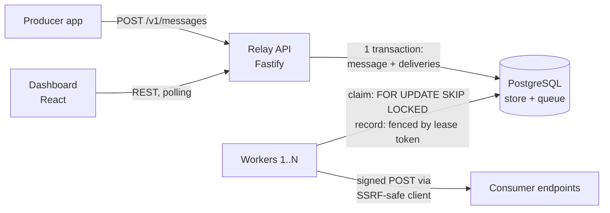

# Relay

Reliable webhook delivery. Applications publish events to Relay; Relay delivers them to
subscribed HTTP endpoints with **at-least-once** delivery, **signed payloads** (Standard
Webhooks), **retries with exponential backoff**, a **dead-letter queue** with replay, a
**per-endpoint circuit breaker**, and **SSRF protection**. It includes an operator
dashboard and a mock consumer for demos.

PostgreSQL is the only moving part besides Node: it is the store **and** the queue.



## Guarantees and how they are enforced

| Guarantee | Mechanism |
|---|---|
| A published event is never lost or half-enqueued | The message and one delivery row per subscribed endpoint are written in **one transaction** |
| Publishing is idempotent | `Idempotency-Key` + a unique index; a retry returns the original (`200`), a different body with the same key is a `409` |
| No delivery is sent by two workers at once | Claims use `SELECT … FOR UPDATE SKIP LOCKED` in a short transaction; **no transaction is ever open during an HTTP request** |
| A crashed worker loses nothing | Every claim sets a lease; a sweeper returns expired leases to the queue and logs a `lease_expired` attempt |
| A slow "zombie" worker cannot overwrite a newer result | Result writes must match `id AND lease_token AND status = 'in_flight'`: zero rows means the lease was lost and the result is discarded |
| Consumers can deduplicate | Delivery is at-least-once; `webhook-id` = the message id, identical on every retry |
| Consumers can verify the sender | [Standard Webhooks](https://www.standardwebhooks.com/) HMAC-SHA256 signatures (`webhook-id`, `webhook-timestamp`, `webhook-signature`), verified by an independent implementation in the mock consumer |
| A dead endpoint does not burn retries or worker capacity | Per-endpoint circuit breaker: open after N consecutive failures, then **exactly one** half-open probe; held deliveries spend no attempts |
| Customer URLs cannot reach internal services | Resolve, validate and **pin** every IP (DNS-rebinding safe); IP literals checked too; private, loopback, link-local, IPv4-mapped IPv6 blocked; redirects not followed; timeout and 1 KB response cap |
| Time is consistent across machines | Every time comparison uses the database clock (`now()`) |

Each of these is pinned by tests, and the core ones by negative controls (the test was run
with the protection removed to prove it fails).

## Quick start

### With Docker (whole stack)

```sh
docker compose up --build
docker compose run --rm api node dist/scripts/create-app.js my-app   # prints an API key once
```

- Dashboard: <http://localhost:8080> (sign in with the key)
- API: <http://localhost:3000> (`/healthz`, `/metrics`, `/v1/…`)
- Mock consumer: <http://localhost:4000> (`/stats`, `/control`)

Run the narrated end-to-end demo inside the stack:

```sh
docker compose --profile demo run --rm demo
```

The compose file uses demo-friendly timings and enables two **development-only** flags so
the worker may call the mock consumer on the private Docker network. It is not a
production deployment.

### Local (Node ≥ 22.12, PostgreSQL ≥ 16)

```sh
cp .env.example .env            # set DATABASE_URL and TEST_DATABASE_URL (…_test)
npm install
npm run migrate -w server
npm run create-app -w server -- my-app
```

Then, in separate terminals:

```sh
npm run dev:api -w server       # http://localhost:3000
npm run dev:worker -w server
npm run dev -w mock-consumer    # http://localhost:4000
npm run dev -w dashboard        # http://localhost:5173
```

To deliver to the local mock consumer (an `http://127.0.0.1` URL), set
`ALLOW_HTTP_ENDPOINTS=true` and `RELAY_ALLOW_PRIVATE_NETWORKS=true` in `.env`. Both default
to `false` and must stay `false` wherever real customer URLs are delivered.

## Demo

`npm run demo -w server` (or the Docker command above) drives a running stack over HTTP,
like a customer would, and narrates five chapters:

1. **Signed delivery:** every request verified by the consumer's own Standard Webhooks code.
2. **Idempotent publish:** the same `Idempotency-Key` twice gives one message.
3. **Outage → circuit breaker:** the endpoint fails, the circuit opens, new messages queue
   up without being sent, one probe goes out after the cooldown, the backlog drains.
4. **Dead letter → replay:** retries exhausted → `dead` → listed in the dead-letter view →
   replayed after the fix; the attempt history is kept.
5. **At-least-once:** a reply slower than Relay's timeout → re-sent with the same
   `webhook-id` → the consumer reports a duplicate and does not process it twice.

To follow along in the dashboard, create your own endpoint pointing at
`http://127.0.0.1:4000/hooks/me` (or `http://mock-consumer:4000/hooks/me` in Docker), switch
the mock consumer to failing with `POST /control {"mode":"fail"}`, and send test events.
You'll see the circuit badge change, the dead-letter queue fill, and replay drain it.

## API

All `/v1` routes require `Authorization: Bearer <api key>`. Errors are always
`{ "error": { "code": "snake_case", "message": "…" } }`.

| Route | Purpose |
|---|---|
| `POST /v1/endpoints` · `GET /v1/endpoints` · `GET/PATCH /v1/endpoints/:id` | Manage endpoints (`url`, `description`, `event_types`, `disabled`) |
| `GET /v1/endpoints/:id/secret` | Reveal the signing secret (`whsec_…`) |
| `POST /v1/messages` | Publish `{ event_type, payload }` (optional `Idempotency-Key`) → `202` |
| `GET /v1/messages` · `GET /v1/messages/:id` | Messages (keyset pagination) and their deliveries |
| `GET /v1/deliveries?status=&endpoint_id=` | Deliveries; `status=dead` is the dead-letter queue |
| `GET /v1/deliveries/:id` · `GET /v1/deliveries/:id/attempts` | One delivery and its attempt timeline |
| `POST /v1/deliveries/:id/replay` · `POST /v1/endpoints/:id/replay-dead` | Replay one / all dead deliveries of an endpoint |
| `GET /healthz` · `GET /metrics` | Health (DB check) and Prometheus gauges (unauthenticated, operator-only) |

```sh
curl -X POST localhost:3000/v1/messages \
  -H "Authorization: Bearer $RELAY_KEY" -H "Content-Type: application/json" \
  -H "Idempotency-Key: order-42-created" \
  -d '{"event_type":"order.created","payload":{"order":42}}'
```

## How the queue works (in one statement)

```sql
WITH due AS (
  SELECT d.id FROM deliveries d JOIN endpoints e ON e.id = d.endpoint_id
   WHERE d.status = 'pending' AND d.next_attempt_at <= now()
     AND NOT e.disabled AND e.circuit_state = 'closed'
   ORDER BY d.next_attempt_at
   LIMIT $free_slots               -- only as many as this worker can send right now
   FOR UPDATE OF d SKIP LOCKED     -- concurrent workers skip each other's rows
)
UPDATE deliveries d
   SET status = 'in_flight', locked_until = now() + $lease,
       lease_token = gen_random_uuid(), attempt_count = d.attempt_count + 1
  FROM due WHERE d.id = due.id
RETURNING …;
```

The full design, including the half-open probe claim, the sweeper, the fencing write, and
the failure-scenario table, is in [docs/ARCHITECTURE.md](docs/ARCHITECTURE.md). The reasons
behind the main choices are in [docs/decisions/](docs/decisions/).

## Repository

```
server/          API, delivery worker, migrations, scripts (Fastify, Zod, pg, pino)
  src/delivery/  backoff, signing, IP policy, SSRF-safe HTTP client (pure + tested)
  src/worker/    claim / record / sweep SQL, worker loop
dashboard/       operator UI (React, Vite, Tailwind; no router or data-fetching library)
mock-consumer/   zero-dependency demo receiver with failure modes
docs/            architecture, decisions (ADRs), progress log, daily plans
```

Plain SQL with parameterised queries, no ORM; no Redis or message broker; configuration
only from environment variables, validated at startup.

## Testing

```sh
npm test -w server          # integration tests against a real PostgreSQL (TEST_DATABASE_URL)
npm test -w mock-consumer   # node:test
npm test -w dashboard       # vitest, pure logic
npm run typecheck
```

686 tests in total (557 server, 20 mock consumer, 109 dashboard). Server tests never mock the database. Among them:
- concurrent workers never double-claim (and never wait on each other);
- expired leases are recovered;
- stale workers are fenced off;
- backoff and exhaustion to `dead`;
- the published Standard Webhooks test vector;
- SSRF blocking, including IP literals and DNS answers pointing inside;
- circuit breaker transitions, including a held-open race for the single probe;
- replay under concurrency;
- the dashboard's real API client against the real API (a contract test);
- the compiled production build.

CI (GitHub Actions) runs everything on Node 22 and 24 with PostgreSQL 16. It also builds
the Docker images, starts the stack and runs the end-to-end demo inside it.

## Limitations and future work

Deliberately out of scope for this version:
- ordered delivery per key;
- secret rotation with dual signatures;
- encryption of secrets at rest;
- per-endpoint rate limits;
- retention and cleanup of old messages;
- multi-user accounts;
- OpenTelemetry;
- a customer-facing portal.

Known trade-offs (for example, a large paused backlog is re-scanned on each poll) are
listed with their reasons in [docs/PROGRESS.md](docs/PROGRESS.md#known-limitations--blockers).
