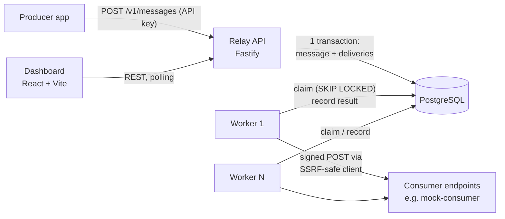

# Relay — Architecture (v0, initial plan)

This is the starting design. The Day 1 Plan Mode session reviews and refines it; any change
is recorded in `docs/PROGRESS.md` (Decisions log).

## 1. System overview



Four processes, one database:

| Process | Responsibility |
|---|---|
| `server` API (`src/server.ts`) | Auth, endpoint management, publishing, querying, replay |
| `server` worker (`src/worker/index.ts`) | Claims due deliveries, sends signed HTTP requests, records results, recovers expired leases |
| `dashboard` | Operator UI: endpoints, messages, attempts, dead-letter queue, replay |
| `mock-consumer` | Demo receiver: verifies signatures, simulates failures, detects duplicates |

**Why API and worker are separate processes from one codebase:** they share the DB layer,
signing and domain types, but have different scaling needs (workers scale with delivery
volume, the API with request volume) and different failure profiles. In Docker Compose
later they become two services built from the same image with different commands.

**Why there is no separate "outbox":** the classic transactional-outbox pattern exists
because the business DB and the message broker are different systems. In Relay, the
`deliveries` table *is* the queue and lives in the same database as `messages`, so one
transaction already makes publish + enqueue atomic. A published message can never exist
without its deliveries, and vice versa.

## 2. Data model (proposed; finalised in Day 1 plan)

All ids are UUIDs (`gen_random_uuid()`); all timestamps are `timestamptz` set by the DB.

**applications** — a tenant.
`id, name, api_key_hash (unique), created_at`
API keys are 32+ random bytes, so a fast SHA-256 hash is sufficient (unlike passwords,
they cannot be brute-forced from a dictionary). The plain key is shown once at creation.

**endpoints** — where an application wants events delivered.
`id, app_id → applications, url, description, event_types text[] (empty = all),
secret, disabled bool, circuit_state ('closed'|'open'|'half_open'),
consecutive_failures int, circuit_open_until timestamptz, created_at, updated_at`

**messages** — an event published once.
`id, app_id, event_type, payload jsonb, idempotency_key text null, created_at`
Partial unique index: `(app_id, idempotency_key) WHERE idempotency_key IS NOT NULL`.

**deliveries** — one message to one endpoint; this table is the queue.
`id, app_id, message_id, endpoint_id, status, attempt_count, next_attempt_at,
locked_until, lease_token, last_error, created_at, updated_at, completed_at`
`UNIQUE (message_id, endpoint_id)`.
Partial index for claiming: `(next_attempt_at) WHERE status = 'pending'`.
Partial index for lease recovery: `(locked_until) WHERE status = 'in_flight'`.
Partial indexes stay small because only active rows are indexed; finished deliveries
(the vast majority over time) cost nothing in the hot path.

**delivery_attempts** — an append-only log; one row per HTTP attempt.
`id bigserial, delivery_id, attempt_number, started_at, duration_ms,
response_status int null, response_excerpt text (≤1 KB), error_kind, error_message`
`error_kind`: `timeout | dns | connection | tls | ssrf_blocked | http_status`.

## 3. Delivery state machine

```mermaid
stateDiagram-v2
  [*] --> pending: publish (fan-out)
  pending --> in_flight: worker claims (lease + lease_token, attempt_count+1)
  in_flight --> succeeded: 2xx response
  in_flight --> pending: failure, attempts left (next_attempt_at = now + backoff)
  in_flight --> dead: failure, attempts exhausted
  in_flight --> pending: lease expired (sweeper; worker presumed dead)
  dead --> pending: replay
  succeeded --> pending: replay (resend)
```



Key rules:
- `attempt_count` is incremented **at claim time**, so an attempt that crashed a worker
  still counts. Otherwise a payload that crashes workers would retry forever.
- A replay resets `attempt_count` to 0 and `next_attempt_at` to now; history is kept in
  `delivery_attempts`.
- Any non-2xx response is retryable (industry norm: consumers return 4xx/5xx for transient
  reasons too). Redirects are treated as failures and never followed.

## 4. The delivery worker

Loop (every `WORKER_POLL_INTERVAL_MS`, plus immediately after a full batch):

1. **Claim** (short transaction):
   ```sql
   WITH due AS (
     SELECT d.id FROM deliveries d
     JOIN endpoints e ON e.id = d.endpoint_id
     WHERE d.status = 'pending' AND d.next_attempt_at <= now()
       AND e.disabled = false
       AND NOT (e.circuit_state = 'open' AND e.circuit_open_until > now())
     ORDER BY d.next_attempt_at
     LIMIT $batch
     FOR UPDATE OF d SKIP LOCKED
   )
   UPDATE deliveries d SET status = 'in_flight',
     locked_until = now() + $lease, lease_token = gen_random_uuid(),
     attempt_count = attempt_count + 1, updated_at = now()
   FROM due WHERE d.id = due.id
   RETURNING d.*;
   ```
   `SKIP LOCKED` lets N workers run this concurrently: each skips rows another worker has
   locked instead of waiting, so no row is claimed twice and no worker blocks.
2. **Deliver** each claimed row **outside any transaction**, with bounded concurrency.
   Holding a transaction (and row locks + a pooled connection) across a 10-second HTTP
   call would exhaust the connection pool and block vacuum.
3. **Record** (short transaction): insert a `delivery_attempts` row, then update the
   delivery with a fenced write:
   `... WHERE id = $1 AND lease_token = $2 AND status = 'in_flight'`.
   If 0 rows match, this worker's lease expired and another worker took over: discard the
   result. This prevents a slow "zombie" worker from overwriting a newer outcome.
   Update the endpoint's circuit state in the same transaction.
4. **Sweep** (every few seconds, any worker): `in_flight` rows with `locked_until < now()`
   go back to `pending` (or `dead` if attempts are exhausted).

Invariant: `LEASE_MS > HTTP_TIMEOUT_MS + margin` (e.g. 30 s vs 10 s), otherwise healthy
slow deliveries would be swept and duplicated.

**Delivery guarantee: at-least-once.** If a worker crashes after the consumer returned
200 but before the result was recorded, the delivery is retried. Exactly-once over HTTP is
impossible without consumer cooperation; Relay provides the cooperation hook: the
`webhook-id` header is the message id, stable across every retry, so consumers dedupe.

**Backoff:** `delay = min(cap, base * 2^(attempt-1))`, then ±20 % random jitter.
Jitter spreads out retries so a recovering endpoint is not hit by a synchronised wave.
Base, cap and max attempts are env-configurable (short values for demos, e.g. base 2 s,
max 6 attempts).

**Circuit breaker (per endpoint):**
- `closed`: normal. Each failure increments `consecutive_failures`; success resets it.
- After `CIRCUIT_FAILURE_THRESHOLD` consecutive failures → `open` until
  `now() + CIRCUIT_COOLDOWN_MS`. The claim query skips this endpoint's deliveries, so
  they wait **without consuming attempts** (an outage should not push everything to DLQ).
- When the cooldown passes, the next result decides: success → `closed`, failure →
  `open` again. Trade-off: several workers may probe concurrently (bounded by batch size);
  documented rather than solved with extra locking.

Why it matters: without it, one dead endpoint with thousands of queued deliveries burns
worker capacity on timeouts and delays healthy endpoints (the noisy-neighbour problem).

## 5. Security

**Signing (Standard Webhooks spec).** Headers on every delivery:
- `webhook-id`: message id
- `webhook-timestamp`: unix seconds at send time
- `webhook-signature`: `v1,<base64(HMAC-SHA256(secret, "{id}.{timestamp}.{body}"))>`

The secret is `whsec_` + base64 of 24–32 random bytes; the HMAC key is the decoded bytes.
Signing the timestamp lets consumers reject replays older than a tolerance window.

**SSRF protection.** Customer-controlled URLs mean an attacker could register
`http://169.254.169.254/` (cloud metadata) or `http://localhost:5432` and make Relay attack
its own network. The SSRF-safe client:
- allows only `https:` (and `http:` when configured for dev), and default ports unless configured;
- performs DNS resolution itself via a custom `lookup` passed to `node:http(s).request`,
  rejecting loopback, private (10/8, 172.16/12, 192.168/16), link-local (169.254/16,
  fe80::/10), CGNAT (100.64/10), unique-local (fc00::/7), multicast, unspecified, and
  IPv4-mapped IPv6 forms of these;
- connects to the *validated* address (the `lookup` result is what the socket uses), which
  defeats DNS rebinding (a hostname that resolves safely at check time, then to 127.0.0.1);
- never follows redirects; enforces a total timeout and reads at most 1 KB of response.

`RELAY_ALLOW_PRIVATE_NETWORKS=true` relaxes the IP rule for local development only
(the mock consumer runs on localhost). Default and test default: false.

**Tenant isolation.** Every query includes `app_id` from the authenticated API key. A
request for another tenant's resource returns 404 (not 403, which would leak existence).

## 6. API (v1)

Auth: `Authorization: Bearer <api key>` on all `/v1` routes.

| Method & path | Purpose |
|---|---|
| `POST /v1/endpoints` | Create endpoint (`url`, `description?`, `event_types?`) |
| `GET /v1/endpoints` | List endpoints incl. circuit state |
| `GET /v1/endpoints/:id` | Get endpoint |
| `PATCH /v1/endpoints/:id` | Update url / event_types / disabled |
| `GET /v1/endpoints/:id/secret` | Reveal signing secret |
| `POST /v1/endpoints/:id/replay-dead` | Bulk replay this endpoint's dead deliveries |
| `POST /v1/messages` | Publish (`event_type`, `payload`, optional `Idempotency-Key` header) → 202 |
| `GET /v1/messages` | List (keyset pagination by `created_at, id`) |
| `GET /v1/messages/:id` | Message + its deliveries |
| `GET /v1/deliveries` | Filter by `status`, `endpoint_id` |
| `GET /v1/deliveries/:id/attempts` | Attempt timeline |
| `POST /v1/deliveries/:id/replay` | Replay one delivery |
| `GET /healthz` | Liveness + DB check (no auth) |

Idempotent publish: `INSERT ... ON CONFLICT DO NOTHING RETURNING`; on conflict the
original message is returned with `200` and `Idempotent-Replayed: true` instead of `202`.
Keyset pagination is used instead of OFFSET because OFFSET gets slower and can skip/duplicate
rows while new messages are being inserted.

## 7. Dashboard

React + Vite + TypeScript + Tailwind. The Vite dev proxy forwards `/v1` to the API (no CORS
setup needed in dev). Views: API-key login, Endpoints (circuit badge), Messages, Message
detail, Delivery attempt timeline, Dead-letter queue with replay. Data refreshes by polling
(~3 s). Minimal dependencies; no state-management or data-fetching library unless justified.

## 8. Mock consumer

Zero-dependency `node:http` server (default port 4000):
- `POST /hooks/:name` verifies the Standard Webhooks signature with its own independent
  implementation (proves interoperability), records `webhook-id`s, and flags duplicates.
- `POST /control` sets the mode: `ok | fail (500) | flaky (fail X %) | slow (delay) | timeout (never respond)`.
- `GET /stats` returns received / duplicates / failures for the demo.

## 9. Configuration (environment variables)

```
DATABASE_URL, TEST_DATABASE_URL
API_PORT=3000, API_HOST=0.0.0.0
WORKER_ID (default: hostname-pid), WORKER_BATCH_SIZE=20, WORKER_CONCURRENCY=10,
WORKER_POLL_INTERVAL_MS=500, LEASE_MS=30000, SWEEP_INTERVAL_MS=5000
HTTP_TIMEOUT_MS=10000, MAX_PAYLOAD_BYTES=262144
RETRY_BASE_MS=2000, RETRY_CAP_MS=600000, MAX_ATTEMPTS=6
CIRCUIT_FAILURE_THRESHOLD=5, CIRCUIT_COOLDOWN_MS=30000
RELAY_ALLOW_PRIVATE_NETWORKS=false, ALLOW_HTTP_ENDPOINTS=false
LOG_LEVEL=info
```

Run with `node --env-file=.env` (or `tsx --env-file=.env`). Because everything is env-driven
and the API binds `0.0.0.0`, the same code runs unchanged in Docker Compose later.

## 10. Failure scenarios and how they are handled

| Scenario | Handling |
|---|---|
| Producer retries a publish after a network blip | Idempotency key → same message returned, no duplicate deliveries |
| API crashes mid-publish | Single transaction rolls back; nothing partially enqueued |
| Two workers poll at the same moment | `FOR UPDATE SKIP LOCKED`: disjoint claims |
| Worker crashes mid-delivery | Lease expires → sweeper returns row to pending; attempt counted |
| Slow worker finishes after its lease expired | Fenced update matches 0 rows → result discarded |
| Consumer got the request but Relay crashed before recording | Redelivered; consumer dedupes on `webhook-id` |
| Endpoint down for 20 minutes | Circuit opens; deliveries wait without spending attempts; resume on recovery |
| Endpoint permanently broken | Attempts exhausted → `dead`; operator replays after fix |
| Consumer hangs forever | HTTP timeout → `timeout` attempt, retried |
| Consumer returns a huge body | Read capped at 1 KB, socket closed |
| Endpoint URL points to internal network / DNS rebinding | SSRF client blocks; attempt logged as `ssrf_blocked` |
| Database unavailable | API returns 503; worker logs and backs off its poll loop, then recovers |
