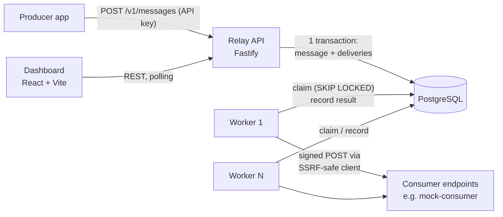
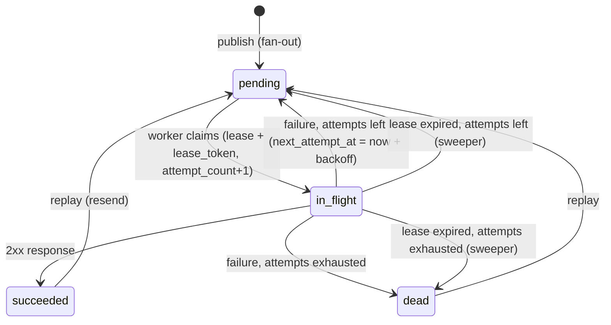

# Relay — Architecture (v1, revised after Day 1 review)

Revised by the Day 1 plan review (2026-11-11). Every change is recorded in
`docs/PROGRESS.md` (Decisions log, D11+). Exact DDL and transition SQL live in
`docs/plans/day1.md` and, once written, `server/migrations/`.

## 1. System overview



Four processes, one database:

| Process | Responsibility |
|---|---|
| `server` API (`src/server.ts`) | Auth, endpoint management, publishing, querying, replay |
| `server` worker (`src/worker/index.ts`) | Claims due deliveries, sends signed HTTP requests, records results, recovers expired leases |
| `dashboard` | Operator UI: endpoints, messages, attempts, dead-letter queue, replay |
| `mock-consumer` | Demo receiver: verifies signatures, simulates failures, detects duplicates |

**Why API and worker are separate processes from one codebase:** they share the DB layer,
signing and domain types, but have different scaling needs (workers scale with delivery
volume, the API with request volume) and different failure profiles. In Docker Compose
later they become two services built from the same image with different commands.

**Why there is no separate "outbox":** the classic transactional-outbox pattern exists
because the business DB and the message broker are different systems. In Relay, the
`deliveries` table *is* the queue and lives in the same database as `messages`, so one
transaction already makes publish + enqueue atomic. A published message can never exist
without its deliveries, and vice versa.

## 2. Data model (final for migration 001)

All ids are UUIDs (`gen_random_uuid()`, PG >= 16 compatible); all timestamps are
`timestamptz` set by the DB. Status fields are `text` + `CHECK` (not enums, so they are easy
to change in later migrations). Ownership cascades: application → endpoints / messages →
deliveries → attempts (`ON DELETE CASCADE`; no v1 API deletes anything).

**applications** — a tenant.
`id, name, api_key_hash bytea (unique, 32 bytes), created_at`
API keys are 32 random bytes, so a fast SHA-256 hash is sufficient (unlike passwords,
they cannot be brute-forced from a dictionary). The plain key is shown once at creation.

**endpoints** — where an application wants events delivered.
`id, app_id → applications, url (≤2048), description, event_types text[] (empty = all,
no NULLs), secret (whsec_…), disabled bool, circuit_state ('closed'|'open'|'half_open'),
consecutive_failures int, circuit_open_until timestamptz, created_at, updated_at`
`UNIQUE (id, app_id)` is the target of composite FKs. `CHECK`: `open` requires
`circuit_open_until`. A disabled endpoint is **paused**: no fan-out, its pending deliveries
are skipped by the claim and resume when re-enabled.

**messages** — an event published once.
`id, app_id, event_type (pattern-checked), payload jsonb (must be an object),
idempotency_key text null (≤255), created_at`
Partial unique index: `(app_id, idempotency_key) WHERE idempotency_key IS NOT NULL`.
Keyset index: `(app_id, created_at DESC, id DESC)`.

**deliveries** — one message to one endpoint; this table is the queue.
`id, app_id, message_id, endpoint_id, status ('pending'|'in_flight'|'succeeded'|'dead'),
attempt_count, next_attempt_at, locked_until, lease_token, locked_by, last_error,
created_at, updated_at, completed_at`
- `UNIQUE (message_id, endpoint_id)`.
- Composite FKs `(message_id, app_id)` and `(endpoint_id, app_id)`: a delivery's tenant must
  equal its message's and endpoint's tenant, so cross-tenant rows are impossible.
- `CHECK`s: lease fields (`locked_until, lease_token, locked_by`) are set **iff**
  `in_flight`; `completed_at` is set iff `succeeded`/`dead`.
- Partial indexes: claim `(next_attempt_at) WHERE status='pending'`; lease recovery
  `(locked_until) WHERE status='in_flight'`; DLQ `(endpoint_id, updated_at) WHERE status='dead'`.
  Plus `(endpoint_id, created_at DESC, id DESC)` and `(app_id, created_at DESC, id DESC)` for lists.
Partial indexes stay small because only active rows are indexed; finished deliveries
(the vast majority over time) cost nothing in the hot path.

**delivery_attempts** — an append-only log; **one row per claim**.
`id bigint identity, delivery_id, lease_token uuid UNIQUE, attempt_number, worker_id,
recorded_at (DB clock), duration_ms, response_status int null, response_excerpt (≤1 KB),
error_kind, error_message`
`error_kind`: `timeout | dns | connection | tls | ssrf_blocked | http_status | lease_expired`.
Attempt identity is the claim's `lease_token`, not `attempt_number` (which restarts after a
replay and is display-only). The unique token also guarantees the worker and the sweeper can
never both log the same claim.

## 3. Delivery state machine



| Transition | Performed by |
|---|---|
| ∅ → pending | API publish (fan-out, same transaction as the message) |
| pending → in_flight | Worker claim |
| in_flight → succeeded / pending / dead | Worker record (fenced) |
| in_flight → pending / dead | Sweeper (lease expired) |
| dead / succeeded → pending | Replay (API) |

"Paused" is not a state: a `pending` delivery whose endpoint is disabled or whose circuit is
open is simply not selected by the claim, and consumes no attempt.

Key rules:
- `attempt_count` is incremented **at claim time**, so an attempt that crashed a worker
  still counts. Otherwise a payload that crashes workers would retry forever.
- A replay resets `attempt_count` to 0 and `next_attempt_at` to now; history is kept in
  `delivery_attempts` (keyed by `lease_token`, so old rows never collide). Replay is only
  allowed from `dead` / `succeeded` (otherwise `409 delivery_not_replayable`). A replay for a
  disabled endpoint stays paused until it is re-enabled.
- Every exit from `in_flight` clears `locked_until`, `lease_token` and `locked_by`.
- Any non-2xx response is retryable (industry norm: consumers return 4xx/5xx for transient
  reasons too). Redirects are treated as failures and never followed.

## 4. The delivery worker

Loop (every `WORKER_POLL_INTERVAL_MS`, plus immediately whenever slots free up):

1. **Claim** (one statement = one short transaction). The `LIMIT` is the number of **free
   concurrency slots** (`WORKER_CONCURRENCY` minus requests in progress), so every claimed
   row starts its HTTP request immediately and the lease clock and the HTTP clock start
   together. There is no separate batch size.
   ```sql
   WITH due AS (
     SELECT d.id FROM deliveries d
     JOIN endpoints e ON e.id = d.endpoint_id
     WHERE d.status = 'pending' AND d.next_attempt_at <= now()
       AND NOT e.disabled
       AND e.circuit_state = 'closed'      -- open / half_open endpoints: probe claim only (below)
     ORDER BY d.next_attempt_at
     LIMIT $free_slots
     FOR UPDATE OF d SKIP LOCKED
   )
   UPDATE deliveries d SET status = 'in_flight',
     locked_until = now() + $lease, lease_token = gen_random_uuid(), locked_by = $worker_id,
     attempt_count = d.attempt_count + 1, updated_at = now()
   FROM due WHERE d.id = due.id
   RETURNING d.id, d.message_id, d.endpoint_id, d.attempt_count, d.lease_token;
   ```
   (Implemented in `server/src/worker/queue.ts`. The real statement also joins `messages` and
   `endpoints` in `UPDATE … FROM` and returns `payload::text AS body, url, secret`, so the
   worker gets everything it needs to send in the same round trip, D45.)
   `SKIP LOCKED` lets N workers run this concurrently: each skips rows another worker has
   locked instead of waiting, so no row is claimed twice and no worker blocks. After locking,
   Postgres re-checks the `WHERE` on the newest row version, so a row another worker just
   moved to `in_flight` is dropped. `FOR UPDATE OF d` locks only delivery rows: locking the
   joined endpoint rows would make other workers skip every delivery of that endpoint.
2. **Deliver** each claimed row **outside any transaction**. Holding a transaction (and row
   locks + a pooled connection) across a 10-second HTTP call would exhaust the connection
   pool and block vacuum. The body sent and signed is exactly `payload::text`.
3. **Record** (short transaction): first the fenced update
   `... WHERE id = $1 AND lease_token = $2 AND status = 'in_flight' RETURNING ...`
   (success → `succeeded`; failure → `pending` with backoff, or `dead` when
   `attempt_count >= MAX_ATTEMPTS`, decided by a `CASE` in the same statement). Only if it
   matched a row, insert the `delivery_attempts` row (with the claim's `lease_token`) and
   update the endpoint's circuit state in the same transaction.
   If 0 rows match, this worker's lease was taken over: log it and discard the result. This
   prevents a slow "zombie" worker from overwriting a newer outcome. The fence is the
   **token, not the clock**: if the lease expired but nobody has swept it yet, the token still
   matches and the result is accepted.
4. **Sweep** (every `SWEEP_INTERVAL_MS`, any worker, `FOR UPDATE SKIP LOCKED` so concurrent
   sweepers are safe): `in_flight` rows with `locked_until < now()` go back to `pending`
   (or `dead` if attempts are exhausted), and a `lease_expired` attempt row is written with
   the expired `lease_token` and `locked_by`, so crashed attempts appear in the timeline.

**Loop mechanics** (`server/src/worker/worker.ts`): after a claim the loop sleeps
`WORKER_POLL_INTERVAL_MS`, but a finishing delivery wakes it at once to fill the freed slot.
A failing claim (database down) is logged and retried with a doubling back-off capped at 5 s.
The sweeper runs in every worker on its own timer, first at start-up. Shutdown
(SIGINT/SIGTERM): stop claiming and sweeping, wait up to `HTTP_TIMEOUT_MS + 5 s` for
in-progress deliveries to finish and be recorded, then close the pool; anything unfinished
is recovered by lease expiry. The worker pool has `min(concurrency, 18) + 2` connections:
connections are held only for single short statements, never during HTTP.

Invariant: `LEASE_MS >= 2 * HTTP_TIMEOUT_MS + 5000` (enforced by config validation; defaults
30 s vs 10 s). Otherwise healthy slow deliveries would be swept and duplicated.

**Database safety nets.** API and worker pools set `statement_timeout` and
`idle_in_transaction_session_timeout` (`DB_STATEMENT_TIMEOUT_MS`, `DB_IDLE_IN_TX_TIMEOUT_MS`),
so Postgres kills a leaked transaction instead of letting it block the queue. The migration
runner uses its own connection **without** `statement_timeout`, so long migrations and
advisory-lock waits are never cancelled. Every pool has an `'error'` handler so a DB restart
cannot crash the process. pg-pool removes that handler from a client while it is checked
out, so every multi-statement transaction goes through `withTransaction()`
(`server/src/db/tx.ts`): it attaches its own `'error'` listener for the checkout, rolls back
on any throw, and destroys (rather than returns) a client whose connection broke.

**Delivery guarantee: at-least-once.** If a worker crashes after the consumer returned
200 but before the result was recorded, the delivery is retried. Exactly-once over HTTP is
impossible without consumer cooperation; Relay provides the cooperation hook: the
`webhook-id` header is the message id, stable across every retry, so consumers dedupe.

**Backoff:** `delay = min(cap, base * 2^(attempt-1))`, then ±20 % random jitter.
Jitter spreads out retries so a recovering endpoint is not hit by a synchronised wave.
Base, cap and max attempts are env-configurable (short values for demos, e.g. base 2 s,
max 6 attempts).

**Circuit breaker (per endpoint):**
- `closed`: normal. Each failure increments `consecutive_failures`; success resets it.
- After `CIRCUIT_FAILURE_THRESHOLD` consecutive failures → `open` until
  `now() + CIRCUIT_COOLDOWN_MS`. The claim query skips this endpoint's deliveries, so
  they wait **without consuming attempts** (an outage should not push everything to DLQ).
- `half_open` is a **single-probe** state. The normal claim only takes deliveries of
  `closed` endpoints. Before it, each claim runs a separate **probe claim** with the same
  free slots (`claimProbes` in `server/src/worker/queue.ts`):
  ```sql
  WITH candidates AS (            -- cooled down, enabled, with a due delivery
    SELECT e.id FROM endpoints e
     WHERE e.circuit_state IN ('open', 'half_open') AND e.circuit_open_until <= now()
       AND NOT e.disabled
       AND EXISTS (SELECT 1 FROM deliveries d WHERE d.endpoint_id = e.id
                     AND d.status = 'pending' AND d.next_attempt_at <= now())
     ORDER BY e.circuit_open_until LIMIT $free_slots
     FOR UPDATE SKIP LOCKED       -- the endpoint row lock: only ONE worker wins it
  ), promoted AS (
    UPDATE endpoints e SET circuit_state = 'half_open',
           circuit_open_until = now() + $lease          -- the probe deadline
      FROM candidates c WHERE e.id = c.id
    RETURNING e.id, e.url, e.secret
  ), probe AS (                   -- exactly one due delivery per promoted endpoint
    SELECT x.id FROM promoted p CROSS JOIN LATERAL (
      SELECT d.id FROM deliveries d
       WHERE d.endpoint_id = p.id AND d.status = 'pending' AND d.next_attempt_at <= now()
       ORDER BY d.next_attempt_at LIMIT 1 FOR UPDATE SKIP LOCKED) x
  )
  UPDATE deliveries d SET status = 'in_flight', … (same lease columns as the normal claim)
    FROM probe, messages m, promoted p WHERE d.id = probe.id AND … RETURNING …;
  ```
  The endpoint row lock is what makes the probe single: a second worker skips the locked
  row, and once the first commits, the endpoint is `half_open` with a deadline in the future,
  so it is no longer a candidate. Everyone else's deliveries for that endpoint wait (they are
  not `closed`) without spending attempts. Probe success → `closed` (counter reset); failure
  → `open` again with a fresh cooldown.
- **The probe deadline makes `half_open` self-healing.** `circuit_open_until` on a
  `half_open` endpoint is `now() + LEASE_MS`. If the probe's worker crashes, or its result is
  discarded as `lease_lost`, nobody would ever close or re-open the circuit; instead, once the
  deadline passes, the endpoint is a candidate again and a new probe goes out. No coupling
  with the sweeper is needed.
- **Where the circuit is updated:** inside `recordResult`'s transaction, after the fenced
  delivery update and the attempt row, so the circuit always agrees with the attempt log.
  A discarded (`lease_lost`) result does not touch the circuit. Lock order is always delivery
  row, then endpoint row; the probe claim never waits for a lock (`SKIP LOCKED`), so the two
  paths cannot deadlock.
- No-op circuit writes are skipped (`WHERE consecutive_failures <> 0 OR circuit_state <> 'closed'`)
  to limit contention on the endpoint row.
- Tested by holding a probe claim's transaction open while another worker claims: it gets
  nothing and does not block. A plain "8 concurrent claimers" test did NOT catch a missing
  candidates lock (the window is too short to hit), so the held-open test is the real guard.

Why it matters: without it, one dead endpoint with thousands of queued deliveries burns
worker capacity on timeouts and delays healthy endpoints (the noisy-neighbour problem).

## 5. Security

**Signing (Standard Webhooks spec).** Headers on every delivery:
- `webhook-id`: message id
- `webhook-timestamp`: unix seconds at send time
- `webhook-signature`: `v1,<base64(HMAC-SHA256(secret, "{id}.{timestamp}.{body}"))>`

The secret is `whsec_` + base64 of 24 random bytes; the HMAC key is the decoded bytes.
Signing the timestamp lets consumers reject replays older than a tolerance window.
`{body}` is exactly the bytes sent (`payload::text`, serialised once).
`webhook-timestamp` is the **only** place the worker's own clock is used (the spec requires
send time; the consumer compares it with its own clock). Everything Relay compares uses
the DB clock.

**SSRF protection.** Customer-controlled URLs mean an attacker could register
`http://169.254.169.254/` (cloud metadata) or `http://localhost:5432` and make Relay attack
its own network. The SSRF-safe client:
- allows only `https:` (and `http:` when configured for dev), on any port (D41: the IP rules
  are the protection; real consumers use ports like 8443);
- classifies IP-literal hosts (`http://127.0.0.1/`, `[::1]`) **before** the request, because
  Node never calls `lookup` for an IP literal (D43);
- performs DNS resolution itself via a custom `lookup` passed to `node:http(s).request`
  (`server/src/delivery/http-client.ts`, the only code that calls customer URLs). If **any**
  resolved address is disallowed, the whole hostname is blocked (D42). Rules
  (`server/src/delivery/ip-policy.ts`, D44): IPv4 is a block list of every special range
  (loopback, private, link-local / cloud metadata, CGNAT 100.64/10, documentation,
  benchmarking, multicast, reserved); IPv6 is an allow list, only global unicast `2000::/3`
  minus documentation, 6to4 and Teredo; IPv4-mapped (`::ffff:…`, which is how the URL parser
  writes `[::ffff:127.0.0.1]`) and NAT64 (`64:ff9b::/96`) addresses are judged by the
  embedded IPv4. Anything unparseable is blocked;
- connects to the *validated* address (the `lookup` result is what the socket uses), which
  defeats DNS rebinding (a hostname that resolves safely at check time, then to 127.0.0.1).
  TLS still verifies the certificate against the hostname, not the pinned IP;
- never follows redirects (a 3xx is a failure); uses a fresh connection per request
  (`agent: false`); enforces one total deadline (DNS + connect + TLS + response) and reads
  at most 1 KB of response, then destroys the socket. The outcome is decided by the status
  line (D47);
- sanitises what it stores (D46, D52): the excerpt is UTF-8 decoded, NULs stripped, ≤ 1024
  characters; a status outside 100–599 is a failure stored without a status. Both are
  consumer-controlled and would otherwise make the result write fail forever.

`RELAY_ALLOW_PRIVATE_NETWORKS=true` relaxes the IP rule for local development only
(the mock consumer runs on localhost). Default and test default: false.

At endpoint create/update time the API also rejects bad URLs early: scheme must be `https:`
(or `http:` with `ALLOW_HTTP_ENDPOINTS=true`), no credentials (`user:pass@`), ≤ 2048 chars.
This is for fast feedback only; the send-time check is the real enforcement (DNS can change).

**Tenant isolation.** Every query includes `app_id` from the authenticated API key. A
request for another tenant's resource returns 404 (not 403, which would leak existence).

## 6. API (v1)

Auth: `Authorization: Bearer <api key>` on all `/v1` routes.

| Method & path | Purpose |
|---|---|
| `POST /v1/endpoints` | Create endpoint (`url`, `description?`, `event_types?`) |
| `GET /v1/endpoints` | List endpoints incl. circuit state |
| `GET /v1/endpoints/:id` | Get endpoint |
| `PATCH /v1/endpoints/:id` | Update url / event_types / disabled |
| `GET /v1/endpoints/:id/secret` | Reveal signing secret |
| `POST /v1/endpoints/:id/replay-dead` | Bulk replay this endpoint's dead deliveries → 202 `{ replayed }` |
| `POST /v1/messages` | Publish (`event_type`, `payload`, optional `Idempotency-Key` header) → 202 |
| `GET /v1/messages` | List (keyset pagination by `created_at, id`) |
| `GET /v1/messages/:id` | Message + its deliveries |
| `GET /v1/deliveries` | List newest first, keyset-paginated; filter by `status`, `endpoint_id` (`status=dead` = the DLQ view) |
| `GET /v1/deliveries/:id` | One delivery with its `event_type` (added on Day 3 for the dashboard) |
| `GET /v1/deliveries/:id/attempts` | Attempt timeline, oldest first (`{ data }`; empty, not 404, before the first attempt) |
| `POST /v1/deliveries/:id/replay` | Replay one `dead` or `succeeded` delivery → 202 `{ delivery }` |
| `GET /healthz` | Liveness + DB check (no auth) |
| `GET /metrics` | Prometheus text format, aggregate queue gauges (no auth; operator endpoint) |

**Conventions.** Auth runs before the body is parsed. Missing, malformed and unknown keys
all get the same `401 unauthorized` (+ `WWW-Authenticate: Bearer`). Bodies and list query
strings are validated with strict Zod schemas (unknown fields → 400). Errors are always
`{ "error": { "code", "message" } }`:

| Status | `code` | When |
|---|---|---|
| 400 | `validation_failed` | Zod failure; message names the field, e.g. `body.url: scheme must be https` |
| 400 | `invalid_json` | Unparsable/empty JSON, or `__proto__` / `constructor.prototype` keys |
| 401 | `unauthorized` | No valid API key |
| 404 | `not_found` | Unknown route, or a resource that is missing **or owned by another tenant** |
| 409 | `idempotency_key_reused` | Same key, different `event_type` or payload |
| 409 | `delivery_not_replayable` | Replay of a delivery that is still `pending` / `in_flight` |
| 413 | `payload_too_large` | Body over `MAX_PAYLOAD_BYTES` |
| 415 | `unsupported_media_type` | Body that is not `application/json` |
| 500 | `internal_error` | A bug; details only in the server log |
| 503 | `database_unavailable` | Connection errors, statement timeout, too many connections (`Retry-After: 5`) |

A POST without a body must also omit `Content-Type: application/json`: an empty body
declared as JSON is a 400 `invalid_json` (relevant for the replay routes).

Responses: an endpoint's `secret` appears only in the create response and from
`GET /v1/endpoints/:id/secret` (`Cache-Control: no-store`). Lists are `{ "data": [...] }`
(messages and deliveries add `next_cursor`).

**Replay** (T5) sets `status = 'pending'`, `attempt_count = 0`, due now, and clears
`completed_at` / `last_error`; the attempt history is kept (attempt identity is the
`lease_token`, D13, so a restarted `attempt_number` never collides). The status condition is
in the `UPDATE`'s `WHERE`, so check-and-change is atomic: of two concurrent replays exactly
one gets 202, the other 409. Only `dead` and `succeeded` can be replayed; resetting a
`pending` / `in_flight` row would fight the worker that holds its lease. A replay for a
disabled endpoint stays paused, and one for an open circuit waits for the probe. Bulk
replay is one statement whose CTE checks the endpoint belongs to the caller (404 otherwise).

**Delivery list filters** are one static statement with `($n IS NULL OR column = $n)`.
node-postgres sends unnamed statements, which Postgres plans with the actual values, so the
unused branches fold away; `EXPLAIN` on 50 000 rows confirmed each filter combination uses
the right index (`deliveries_app_keyset_idx`, `deliveries_endpoint_idx`). The cursor code is
shared with the message list (`server/src/db/cursor.ts`).

**`GET /metrics`** reads everything from Postgres at scrape time (no in-process counters that
would differ per replica and reset on restart). Gauges: `relay_deliveries{status}` for
`pending | in_flight | dead`, `relay_deliveries_due`, `relay_oldest_due_delivery_age_seconds`
(queue lag, DB clock), `relay_endpoints{circuit_state}`, `relay_endpoints_disabled`. It is
aggregate-only (no tenant or endpoint labels: no cross-tenant leak, fixed cardinality) and
unauthenticated like `/healthz`, so restrict it at the network level in production. Only
statuses with a partial index are counted (`EXPLAIN`: index-only scans); `succeeded` is the
unbounded history and is deliberately absent. Database down → 503, a failed scrape rather
than fake zeros. Publish returns `{ message, deliveries }` without echoing the
payload; the message list omits payloads; `GET /v1/messages/:id` includes the payload and
the deliveries (lease fields are internal and never exposed).

Publish: `payload` must be a JSON object. Valid JSON that jsonb cannot store (`\u0000`, an
unpaired surrogate) is a 400, not a 500. Fan-out creates one delivery per **enabled**
endpoint whose `event_types` is empty or contains the event type, in the same transaction.

Idempotent publish: `INSERT ... ON CONFLICT (app_id, idempotency_key) WHERE idempotency_key
IS NOT NULL DO NOTHING RETURNING`. `DO NOTHING` returns no row on conflict, so a follow-up
`SELECT` in the same transaction fetches the original. Same `event_type` and payload (jsonb
equality, key-order-insensitive) → original returned with `200` and
`Idempotent-Replayed: true` instead of `202`. Different body → `409 idempotency_key_reused`.
Keys are kept forever in this build (expiry is future work). Concurrent requests with the
same key: the later insert waits on the unique index, then reads the winner.
Keyset pagination is used instead of OFFSET because OFFSET gets slower and can skip/duplicate
rows while new messages are being inserted. Order is `created_at DESC, id DESC` (`id` breaks
ties between messages from one transaction); the next page is `(created_at, id) < (cursor)`,
an index range scan on `messages_app_keyset_idx`. The cursor is base64url of
`<created_at in epoch microseconds>|<id>`, computed in SQL: a JS `Date` keeps only
milliseconds, and a millisecond cursor would skip rows created within the same millisecond.

## 7. Dashboard

React + Vite + TypeScript + Tailwind. The Vite dev proxy forwards `/v1` to the API (no CORS
setup needed in dev). Views: API-key login, Endpoints (circuit badge), Messages, Message
detail, Delivery attempt timeline, Dead-letter queue with replay. Data refreshes by polling
(~3 s). Minimal dependencies; no state-management or data-fetching library unless justified.

## 8. Mock consumer

Zero-dependency `node:http` server (`mock-consumer/`, default `127.0.0.1:4000`). Plain
JavaScript with JSDoc types checked by `tsc --checkJs`, tested with `node:test`, so it runs
with bare `node` and no build step.
- `POST /hooks/:name` verifies the Standard Webhooks signature with its own independent
  implementation (`src/verify.js`, no code shared with `server/`), checked against the
  published test vector and, in `server/test/worker/mock-consumer.test.ts`, against live
  traffic from the real worker (a broken verifier makes that test fail). Bad signature → 401.
  A hook with no secret configured is accepted but counted as `unverified`.
- Duplicates per hook: a `webhook-id` that was already answered 2xx is a **duplicate**
  (answered 200, not re-processed); one seen before but failed is an ordinary **retry**.
- `POST /control` `{ hook?, mode?, fail_rate?, delay_ms?, secret?, reset? }` sets behaviour
  globally or per hook: `ok | fail (500) | flaky (fail_rate) | slow (delay_ms, then 200) |
  timeout (never respond)`. Secrets are never echoed back.
- `GET /stats` returns counters per hook (received, processed, failed, retries, duplicates,
  invalid_signatures, unverified, held) and the last 50 requests.

**Demo** (`npm run demo -w server`, `server/src/demo/run-demo.ts`): drives a running API,
worker and mock consumer over HTTP and narrates: signed delivery; idempotent publish; outage
→ circuit opens and holds the backlog → recovery; dead letter → DLQ view → bulk replay; a
reply slower than Relay's timeout → re-sent with the same `webhook-id` → duplicate detected.
It creates a fresh application per run and never prints the key. Its wait limits come from
the worker config (`worstCaseDeadMs`). Tested end to end with fast timings.

## 9. Configuration (environment variables)

```
DATABASE_URL, TEST_DATABASE_URL
API_PORT=3000, API_HOST=0.0.0.0
WORKER_ID (default: hostname-pid), WORKER_CONCURRENCY=10,
WORKER_POLL_INTERVAL_MS=500, LEASE_MS=30000, SWEEP_INTERVAL_MS=5000
HTTP_TIMEOUT_MS=10000, MAX_PAYLOAD_BYTES=262144
DB_STATEMENT_TIMEOUT_MS=5000, DB_IDLE_IN_TX_TIMEOUT_MS=10000
RETRY_BASE_MS=2000, RETRY_CAP_MS=600000, MAX_ATTEMPTS=6
CIRCUIT_FAILURE_THRESHOLD=5, CIRCUIT_COOLDOWN_MS=30000
RELAY_ALLOW_PRIVATE_NETWORKS=false, ALLOW_HTTP_ENDPOINTS=false
LOG_LEVEL=info

# mock consumer (not read by server/)
MOCK_PORT=4000, MOCK_HOST=127.0.0.1, MOCK_SECRET (optional), MOCK_QUIET=false
# demo script
DEMO_API_URL (default http://127.0.0.1:$API_PORT), DEMO_MOCK_URL (default http://127.0.0.1:4000)
```

Validation rules: `LEASE_MS >= 2 * HTTP_TIMEOUT_MS + 5000`; booleans accept only
`"true"`/`"false"` (a naive coercion would turn `"false"` into `true`). There is no batch
size: a worker claims as many rows as it has free concurrency slots.

Run with `node --env-file-if-exists=../.env --import tsx …` (Node >= 22.9). The flag is a
no-op when the file is absent, so in Docker/CI real environment variables apply. Because
everything is env-driven and the API binds `0.0.0.0`, the same code runs unchanged in
Docker Compose later.

## 10. Failure scenarios and how they are handled

| Scenario | Handling |
|---|---|
| Producer retries a publish after a network blip | Idempotency key → same message returned, no duplicate deliveries |
| Two identical publishes race | Unique index serialises them: one 202, the other waits and gets 200 with the original |
| Same idempotency key, different body | `409 idempotency_key_reused` |
| API crashes mid-publish | Single transaction rolls back; nothing partially enqueued |
| Two workers poll at the same moment | `FOR UPDATE SKIP LOCKED`: disjoint claims |
| Worker crashes mid-delivery | Lease expires → sweeper returns row to pending (or dead); `lease_expired` attempt logged; attempt counted |
| Slow worker finishes after its lease expired and was reclaimed | Fenced update matches 0 rows → result discarded |
| Clocks differ between machines | All comparisons use `now()`; worker clock only sets `webhook-timestamp` |
| Leaked / stuck DB transaction | `idle_in_transaction_session_timeout` / `statement_timeout` terminate it |
| Consumer got the request but Relay crashed before recording | Redelivered; consumer dedupes on `webhook-id` |
| Endpoint down for 20 minutes | Circuit opens; deliveries wait without spending attempts; a single half-open probe closes it on recovery |
| Worker crashes while holding the half-open probe | Probe deadline (`LEASE_MS`) passes → endpoint is a probe candidate again; the probe delivery itself is recovered by the sweeper |
| Operator replays a delivery while another replay of it is running | Status check is in the `UPDATE`'s `WHERE`: one 202, one 409 |
| Consumer processed the webhook but replied after Relay's timeout | Recorded as `timeout`, re-sent with the same `webhook-id`; the consumer dedupes (shown by the demo) |
| Endpoint disabled by the operator | Deliveries paused (not fanned out / not claimed); resume on re-enable |
| Endpoint permanently broken | Attempts exhausted → `dead`; operator replays after fix |
| Consumer hangs forever | HTTP timeout → `timeout` attempt, retried |
| Consumer returns a huge body | Read capped at 1 KB, socket closed |
| Endpoint URL points to internal network / DNS rebinding | SSRF client blocks; attempt logged as `ssrf_blocked` |
| Endpoint URL is an IP literal (`http://[::ffff:127.0.0.1]/`) | Classified before connecting (Node skips `lookup` for literals); `ssrf_blocked` |
| Consumer returns NUL bytes or a status like 999 | Excerpt sanitised, invalid status stored as a failure without a status; the result is always storable |
| DB connection dies inside a transaction | `withTransaction` catches the client `'error'` (no crash), the server rolls back, the broken client is destroyed; API returns 503. If it died during COMMIT the outcome is unknown: a retry with the same `Idempotency-Key` is safe |
| Payload is valid JSON but jsonb can't store it (`\u0000`) | Rejected with 400 before anything is stored |
| Database unavailable / restarted | Pool `'error'` handler prevents a crash; API returns 503 `database_unavailable`; worker logs and backs off its poll loop, then recovers; unrecorded results are redelivered after lease expiry |
