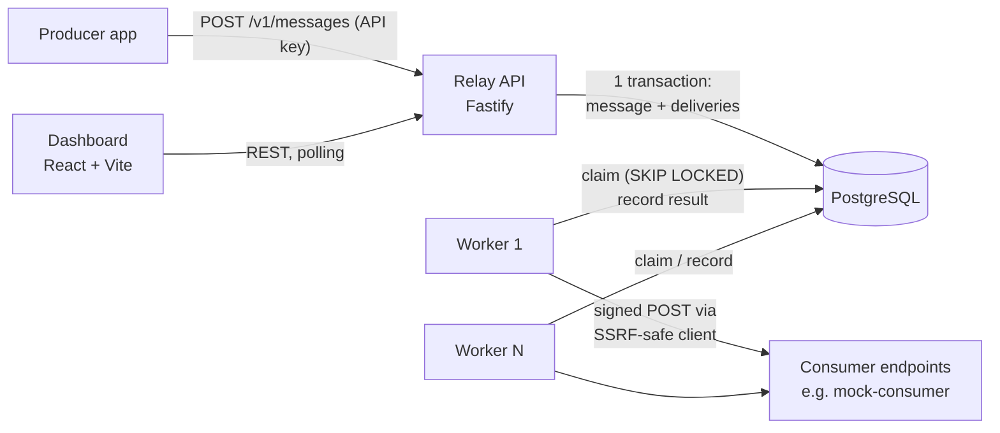
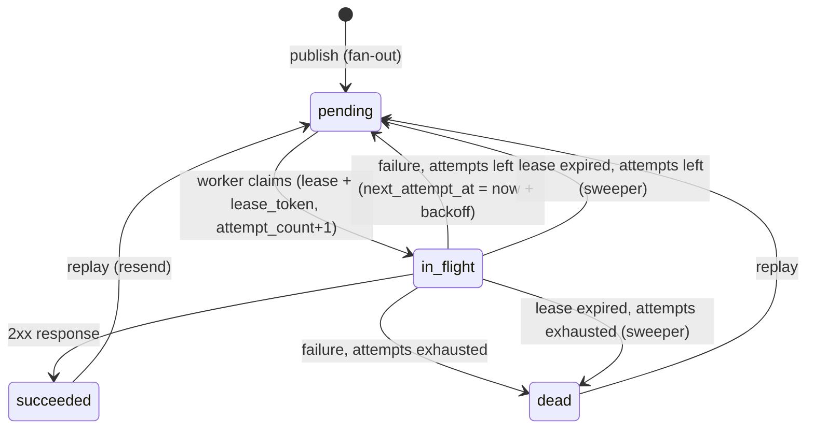

# Relay — Architecture (v1, revised after Day 1 review)

Revised by the Day 1 plan review (2026-11-11). Every change is recorded in
`docs/PROGRESS.md` (Decisions log, D11+). Exact DDL and transition SQL live in
`docs/plans/day1.md` and, once written, `server/migrations/`.

## 1. System overview



Four processes, one database:

| Process | Responsibility |
|---|---|
| `server` API (`src/server.ts`) | Auth, endpoint management, publishing, querying, replay |
| `server` worker (`src/worker/index.ts`) | Claims due deliveries, sends signed HTTP requests, records results, recovers expired leases |
| `dashboard` | Operator UI: endpoints, messages, attempts, dead-letter queue, replay |
| `mock-consumer` | Demo receiver: verifies signatures, simulates failures, detects duplicates |

**Why API and worker are separate processes from one codebase:** they share the DB layer,
signing and domain types, but have different scaling needs (workers scale with delivery
volume, the API with request volume) and different failure profiles. In Docker Compose
later they become two services built from the same image with different commands.

**Why there is no separate "outbox":** the classic transactional-outbox pattern exists
because the business DB and the message broker are different systems. In Relay, the
`deliveries` table *is* the queue and lives in the same database as `messages`, so one
transaction already makes publish + enqueue atomic. A published message can never exist
without its deliveries, and vice versa.

## 2. Data model (final for migration 001)

All ids are UUIDs (`gen_random_uuid()`, PG >= 16 compatible); all timestamps are
`timestamptz` set by the DB. Status fields are `text` + `CHECK` (not enums, so they are easy
to change in later migrations). Ownership cascades: application → endpoints / messages →
deliveries → attempts (`ON DELETE CASCADE`; no v1 API deletes anything).

**applications** — a tenant.
`id, name, api_key_hash bytea (unique, 32 bytes), created_at`
API keys are 32 random bytes, so a fast SHA-256 hash is sufficient (unlike passwords,
they cannot be brute-forced from a dictionary). The plain key is shown once at creation.

**endpoints** — where an application wants events delivered.
`id, app_id → applications, url (≤2048), description, event_types text[] (empty = all,
no NULLs), secret (whsec_…), disabled bool, circuit_state ('closed'|'open'|'half_open'),
consecutive_failures int, circuit_open_until timestamptz, created_at, updated_at`
`UNIQUE (id, app_id)` is the target of composite FKs. `CHECK`: `open` requires
`circuit_open_until`. A disabled endpoint is **paused**: no fan-out, its pending deliveries
are skipped by the claim and resume when re-enabled.

**messages** — an event published once.
`id, app_id, event_type (pattern-checked), payload jsonb (must be an object),
idempotency_key text null (≤255), created_at`
Partial unique index: `(app_id, idempotency_key) WHERE idempotency_key IS NOT NULL`.
Keyset index: `(app_id, created_at DESC, id DESC)`.

**deliveries** — one message to one endpoint; this table is the queue.
`id, app_id, message_id, endpoint_id, status ('pending'|'in_flight'|'succeeded'|'dead'),
attempt_count, next_attempt_at, locked_until, lease_token, locked_by, last_error,
created_at, updated_at, completed_at`
- `UNIQUE (message_id, endpoint_id)`.
- Composite FKs `(message_id, app_id)` and `(endpoint_id, app_id)`: a delivery's tenant must
  equal its message's and endpoint's tenant, so cross-tenant rows are impossible.
- `CHECK`s: lease fields (`locked_until, lease_token, locked_by`) are set **iff**
  `in_flight`; `completed_at` is set iff `succeeded`/`dead`.
- Partial indexes: claim `(next_attempt_at) WHERE status='pending'`; lease recovery
  `(locked_until) WHERE status='in_flight'`; DLQ `(endpoint_id, updated_at) WHERE status='dead'`.
  Plus `(endpoint_id, created_at DESC, id DESC)` and `(app_id, created_at DESC, id DESC)` for lists.
Partial indexes stay small because only active rows are indexed; finished deliveries
(the vast majority over time) cost nothing in the hot path.

**delivery_attempts** — an append-only log; **one row per claim**.
`id bigint identity, delivery_id, lease_token uuid UNIQUE, attempt_number, worker_id,
recorded_at (DB clock), duration_ms, response_status int null, response_excerpt (≤1 KB),
error_kind, error_message`
`error_kind`: `timeout | dns | connection | tls | ssrf_blocked | http_status | lease_expired`.
Attempt identity is the claim's `lease_token`, not `attempt_number` (which restarts after a
replay and is display-only). The unique token also guarantees the worker and the sweeper can
never both log the same claim.

## 3. Delivery state machine



| Transition | Performed by |
|---|---|
| ∅ → pending | API publish (fan-out, same transaction as the message) |
| pending → in_flight | Worker claim |
| in_flight → succeeded / pending / dead | Worker record (fenced) |
| in_flight → pending / dead | Sweeper (lease expired) |
| dead / succeeded → pending | Replay (API) |

"Paused" is not a state: a `pending` delivery whose endpoint is disabled or whose circuit is
open is simply not selected by the claim, and consumes no attempt.

Key rules:
- `attempt_count` is incremented **at claim time**, so an attempt that crashed a worker
  still counts. Otherwise a payload that crashes workers would retry forever.
- A replay resets `attempt_count` to 0 and `next_attempt_at` to now; history is kept in
  `delivery_attempts` (keyed by `lease_token`, so old rows never collide). Replay is only
  allowed from `dead` / `succeeded` (otherwise `409 delivery_not_replayable`). A replay for a
  disabled endpoint stays paused until it is re-enabled.
- Every exit from `in_flight` clears `locked_until`, `lease_token` and `locked_by`.
- Any non-2xx response is retryable (industry norm: consumers return 4xx/5xx for transient
  reasons too). Redirects are treated as failures and never followed.

## 4. The delivery worker

Loop (every `WORKER_POLL_INTERVAL_MS`, plus immediately whenever slots free up):

1. **Claim** (one statement = one short transaction). The `LIMIT` is the number of **free
   concurrency slots** (`WORKER_CONCURRENCY` minus requests in progress), so every claimed
   row starts its HTTP request immediately and the lease clock and the HTTP clock start
   together. There is no separate batch size.
   ```sql
   WITH due AS (
     SELECT d.id FROM deliveries d
     JOIN endpoints e ON e.id = d.endpoint_id
     WHERE d.status = 'pending' AND d.next_attempt_at <= now()
       AND NOT e.disabled
       AND (e.circuit_state = 'closed'
            OR (e.circuit_state = 'open' AND e.circuit_open_until <= now()))  -- single-probe refinement: Day 3
     ORDER BY d.next_attempt_at
     LIMIT $free_slots
     FOR UPDATE OF d SKIP LOCKED
   )
   UPDATE deliveries d SET status = 'in_flight',
     locked_until = now() + $lease, lease_token = gen_random_uuid(), locked_by = $worker_id,
     attempt_count = d.attempt_count + 1, updated_at = now()
   FROM due WHERE d.id = due.id
   RETURNING d.id, d.message_id, d.endpoint_id, d.attempt_count, d.lease_token;
   ```
   `SKIP LOCKED` lets N workers run this concurrently: each skips rows another worker has
   locked instead of waiting, so no row is claimed twice and no worker blocks. After locking,
   Postgres re-checks the `WHERE` on the newest row version, so a row another worker just
   moved to `in_flight` is dropped. `FOR UPDATE OF d` locks only delivery rows: locking the
   joined endpoint rows would make other workers skip every delivery of that endpoint.
2. **Deliver** each claimed row **outside any transaction**. Holding a transaction (and row
   locks + a pooled connection) across a 10-second HTTP call would exhaust the connection
   pool and block vacuum. The body sent and signed is exactly `payload::text`.
3. **Record** (short transaction): first the fenced update
   `... WHERE id = $1 AND lease_token = $2 AND status = 'in_flight' RETURNING ...`
   (success → `succeeded`; failure → `pending` with backoff, or `dead` when
   `attempt_count >= MAX_ATTEMPTS`, decided by a `CASE` in the same statement). Only if it
   matched a row, insert the `delivery_attempts` row (with the claim's `lease_token`) and
   update the endpoint's circuit state in the same transaction.
   If 0 rows match, this worker's lease was taken over: log it and discard the result. This
   prevents a slow "zombie" worker from overwriting a newer outcome. The fence is the
   **token, not the clock**: if the lease expired but nobody has swept it yet, the token still
   matches and the result is accepted.
4. **Sweep** (every `SWEEP_INTERVAL_MS`, any worker, `FOR UPDATE SKIP LOCKED` so concurrent
   sweepers are safe): `in_flight` rows with `locked_until < now()` go back to `pending`
   (or `dead` if attempts are exhausted), and a `lease_expired` attempt row is written with
   the expired `lease_token` and `locked_by`, so crashed attempts appear in the timeline.

Invariant: `LEASE_MS >= 2 * HTTP_TIMEOUT_MS + 5000` (enforced by config validation; defaults
30 s vs 10 s). Otherwise healthy slow deliveries would be swept and duplicated.

**Database safety nets.** API and worker pools set `statement_timeout` and
`idle_in_transaction_session_timeout` (`DB_STATEMENT_TIMEOUT_MS`, `DB_IDLE_IN_TX_TIMEOUT_MS`),
so Postgres kills a leaked transaction instead of letting it block the queue. The migration
runner uses its own connection **without** `statement_timeout`, so long migrations and
advisory-lock waits are never cancelled. Every pool has an `'error'` handler so a DB restart
cannot crash the process.

**Delivery guarantee: at-least-once.** If a worker crashes after the consumer returned
200 but before the result was recorded, the delivery is retried. Exactly-once over HTTP is
impossible without consumer cooperation; Relay provides the cooperation hook: the
`webhook-id` header is the message id, stable across every retry, so consumers dedupe.

**Backoff:** `delay = min(cap, base * 2^(attempt-1))`, then ±20 % random jitter.
Jitter spreads out retries so a recovering endpoint is not hit by a synchronised wave.
Base, cap and max attempts are env-configurable (short values for demos, e.g. base 2 s,
max 6 attempts).

**Circuit breaker (per endpoint):**
- `closed`: normal. Each failure increments `consecutive_failures`; success resets it.
- After `CIRCUIT_FAILURE_THRESHOLD` consecutive failures → `open` until
  `now() + CIRCUIT_COOLDOWN_MS`. The claim query skips this endpoint's deliveries, so
  they wait **without consuming attempts** (an outage should not push everything to DLQ).
- `half_open` is a **single-probe** state. When the cooldown passes, exactly one worker wins
  `UPDATE endpoints SET circuit_state='half_open' WHERE id=$1 AND circuit_state='open'
  AND circuit_open_until <= now()` and claims one probe delivery; everyone else keeps
  skipping the endpoint. Probe success → `closed` (counter reset); failure → `open` again
  with a new cooldown. This stops a backlog from burning attempts on a stampede of probes.
  (Final claim SQL for this is designed on Day 3.)
- No-op circuit writes are skipped (`WHERE consecutive_failures <> 0 OR circuit_state <> 'closed'`)
  to limit contention on the endpoint row.

Why it matters: without it, one dead endpoint with thousands of queued deliveries burns
worker capacity on timeouts and delays healthy endpoints (the noisy-neighbour problem).

## 5. Security

**Signing (Standard Webhooks spec).** Headers on every delivery:
- `webhook-id`: message id
- `webhook-timestamp`: unix seconds at send time
- `webhook-signature`: `v1,<base64(HMAC-SHA256(secret, "{id}.{timestamp}.{body}"))>`

The secret is `whsec_` + base64 of 24 random bytes; the HMAC key is the decoded bytes.
Signing the timestamp lets consumers reject replays older than a tolerance window.
`{body}` is exactly the bytes sent (`payload::text`, serialised once).
`webhook-timestamp` is the **only** place the worker's own clock is used (the spec requires
send time; the consumer compares it with its own clock). Everything Relay compares uses
the DB clock.

**SSRF protection.** Customer-controlled URLs mean an attacker could register
`http://169.254.169.254/` (cloud metadata) or `http://localhost:5432` and make Relay attack
its own network. The SSRF-safe client:
- allows only `https:` (and `http:` when configured for dev), and default ports unless configured;
- performs DNS resolution itself via a custom `lookup` passed to `node:http(s).request`,
  rejecting loopback, private (10/8, 172.16/12, 192.168/16), link-local (169.254/16,
  fe80::/10), CGNAT (100.64/10), unique-local (fc00::/7), multicast, unspecified, and
  IPv4-mapped IPv6 forms of these;
- connects to the *validated* address (the `lookup` result is what the socket uses), which
  defeats DNS rebinding (a hostname that resolves safely at check time, then to 127.0.0.1);
- never follows redirects; enforces a total timeout and reads at most 1 KB of response.

`RELAY_ALLOW_PRIVATE_NETWORKS=true` relaxes the IP rule for local development only
(the mock consumer runs on localhost). Default and test default: false.

At endpoint create/update time the API also rejects bad URLs early: scheme must be `https:`
(or `http:` with `ALLOW_HTTP_ENDPOINTS=true`), no credentials (`user:pass@`), ≤ 2048 chars.
This is for fast feedback only; the send-time check is the real enforcement (DNS can change).

**Tenant isolation.** Every query includes `app_id` from the authenticated API key. A
request for another tenant's resource returns 404 (not 403, which would leak existence).

## 6. API (v1)

Auth: `Authorization: Bearer <api key>` on all `/v1` routes.

| Method & path | Purpose |
|---|---|
| `POST /v1/endpoints` | Create endpoint (`url`, `description?`, `event_types?`) |
| `GET /v1/endpoints` | List endpoints incl. circuit state |
| `GET /v1/endpoints/:id` | Get endpoint |
| `PATCH /v1/endpoints/:id` | Update url / event_types / disabled |
| `GET /v1/endpoints/:id/secret` | Reveal signing secret |
| `POST /v1/endpoints/:id/replay-dead` | Bulk replay this endpoint's dead deliveries |
| `POST /v1/messages` | Publish (`event_type`, `payload`, optional `Idempotency-Key` header) → 202 |
| `GET /v1/messages` | List (keyset pagination by `created_at, id`) |
| `GET /v1/messages/:id` | Message + its deliveries |
| `GET /v1/deliveries` | Filter by `status`, `endpoint_id` |
| `GET /v1/deliveries/:id/attempts` | Attempt timeline |
| `POST /v1/deliveries/:id/replay` | Replay one delivery |
| `GET /healthz` | Liveness + DB check (no auth) |

Publish: `payload` must be a JSON object. Fan-out creates one delivery per **enabled**
endpoint whose `event_types` is empty or contains the event type, in the same transaction.

Idempotent publish: `INSERT ... ON CONFLICT (app_id, idempotency_key) WHERE idempotency_key
IS NOT NULL DO NOTHING RETURNING`. `DO NOTHING` returns no row on conflict, so a follow-up
`SELECT` in the same transaction fetches the original. Same `event_type` and payload (jsonb
equality, key-order-insensitive) → original returned with `200` and
`Idempotent-Replayed: true` instead of `202`. Different body → `409 idempotency_key_reused`.
Keys are kept forever in this build (expiry is future work). Concurrent requests with the
same key: the later insert waits on the unique index, then reads the winner.
Keyset pagination is used instead of OFFSET because OFFSET gets slower and can skip/duplicate
rows while new messages are being inserted.

## 7. Dashboard

React + Vite + TypeScript + Tailwind. The Vite dev proxy forwards `/v1` to the API (no CORS
setup needed in dev). Views: API-key login, Endpoints (circuit badge), Messages, Message
detail, Delivery attempt timeline, Dead-letter queue with replay. Data refreshes by polling
(~3 s). Minimal dependencies; no state-management or data-fetching library unless justified.

## 8. Mock consumer

Zero-dependency `node:http` server (default port 4000):
- `POST /hooks/:name` verifies the Standard Webhooks signature with its own independent
  implementation (proves interoperability), records `webhook-id`s, and flags duplicates.
- `POST /control` sets the mode: `ok | fail (500) | flaky (fail X %) | slow (delay) | timeout (never respond)`.
- `GET /stats` returns received / duplicates / failures for the demo.

## 9. Configuration (environment variables)

```
DATABASE_URL, TEST_DATABASE_URL
API_PORT=3000, API_HOST=0.0.0.0
WORKER_ID (default: hostname-pid), WORKER_CONCURRENCY=10,
WORKER_POLL_INTERVAL_MS=500, LEASE_MS=30000, SWEEP_INTERVAL_MS=5000
HTTP_TIMEOUT_MS=10000, MAX_PAYLOAD_BYTES=262144
DB_STATEMENT_TIMEOUT_MS=5000, DB_IDLE_IN_TX_TIMEOUT_MS=10000
RETRY_BASE_MS=2000, RETRY_CAP_MS=600000, MAX_ATTEMPTS=6
CIRCUIT_FAILURE_THRESHOLD=5, CIRCUIT_COOLDOWN_MS=30000
RELAY_ALLOW_PRIVATE_NETWORKS=false, ALLOW_HTTP_ENDPOINTS=false
LOG_LEVEL=info
```

Validation rules: `LEASE_MS >= 2 * HTTP_TIMEOUT_MS + 5000`; booleans accept only
`"true"`/`"false"` (a naive coercion would turn `"false"` into `true`). There is no batch
size: a worker claims as many rows as it has free concurrency slots.

Run with `node --env-file-if-exists=../.env --import tsx …` (Node >= 22.9). The flag is a
no-op when the file is absent, so in Docker/CI real environment variables apply. Because
everything is env-driven and the API binds `0.0.0.0`, the same code runs unchanged in
Docker Compose later.

## 10. Failure scenarios and how they are handled

| Scenario | Handling |
|---|---|
| Producer retries a publish after a network blip | Idempotency key → same message returned, no duplicate deliveries |
| Two identical publishes race | Unique index serialises them: one 202, the other waits and gets 200 with the original |
| Same idempotency key, different body | `409 idempotency_key_reused` |
| API crashes mid-publish | Single transaction rolls back; nothing partially enqueued |
| Two workers poll at the same moment | `FOR UPDATE SKIP LOCKED`: disjoint claims |
| Worker crashes mid-delivery | Lease expires → sweeper returns row to pending (or dead); `lease_expired` attempt logged; attempt counted |
| Slow worker finishes after its lease expired and was reclaimed | Fenced update matches 0 rows → result discarded |
| Clocks differ between machines | All comparisons use `now()`; worker clock only sets `webhook-timestamp` |
| Leaked / stuck DB transaction | `idle_in_transaction_session_timeout` / `statement_timeout` terminate it |
| Consumer got the request but Relay crashed before recording | Redelivered; consumer dedupes on `webhook-id` |
| Endpoint down for 20 minutes | Circuit opens; deliveries wait without spending attempts; a single half-open probe closes it on recovery |
| Endpoint disabled by the operator | Deliveries paused (not fanned out / not claimed); resume on re-enable |
| Endpoint permanently broken | Attempts exhausted → `dead`; operator replays after fix |
| Consumer hangs forever | HTTP timeout → `timeout` attempt, retried |
| Consumer returns a huge body | Read capped at 1 KB, socket closed |
| Endpoint URL points to internal network / DNS rebinding | SSRF client blocks; attempt logged as `ssrf_blocked` |
| Database unavailable / restarted | Pool `'error'` handler prevents a crash; API returns 503 `database_unavailable`; worker logs and backs off its poll loop, then recovers; unrecorded results are redelivered after lease expiry |
